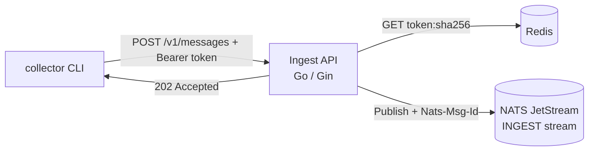

# Skilloom Ingest

High-throughput, fault-tolerant HTTP ingestion service for Skilloom.

It receives AI conversation events from `collector` hooks, verifies client tokens via Redis, and buffers normalized messages in NATS JetStream so downstream workers can batch-write sessions to PostgreSQL without putting the database on the request hot path.

## Request Flow



1. **Authenticate** — extracts the `Bearer` token, hashes it with SHA-256, and resolves `(user_id, space_id)` from Redis.
2. **Validate & Normalize** — checks the incoming payload and wraps it into a slice (`[]Message`) so single-message and future batch endpoints share the same core logic.
3. **Buffer Durably** — publishes to the file-backed NATS JetStream `INGEST` stream (`ingest.>`, `WorkQueuePolicy`) with `event_id` as `Nats-Msg-Id` for deduplication.
4. **Respond Fast** — returns `202 Accepted` well within the collector's 3-second hook timeout.

## Layout

```text
ingest/
├── cmd/ingest/                  # Application entrypoint & Uber Fx wiring
├── config.yaml                  # Default local configuration
└── internal/
    ├── config/                  # YAML + env loader (cleanenv)
    ├── domain/                  # Core models (Message, Principal)
    ├── natsclient/              # NATS JetStream client, stream setup & publish
    ├── services/messages/       # Ingestion service & repository/publisher ports
    ├── store/redis/             # Redis client & KV operations
    └── transport/http/          # Gin server, Fx route groups & /v1 handlers
```

## Configuration

Loaded from `config.yaml` (override path with `CONFIG_PATH`). Every setting can be overridden via environment variables:

| Key | Env Variable | Default |
|---|---|---|
| `http.addr` | `HTTP_ADDR` | `:8080` |
| `nats.url` | `NATS_URL` | `nats://127.0.0.1:4222` |
| `redis.addr` | `REDIS_ADDR` | `127.0.0.1:6379` |
| `redis.password` | `REDIS_PASSWORD` | `""` |
| `redis.db` | `REDIS_DB` | `0` |
| `postgres.dsn` | `POSTGRES_DSN` | `""` |

